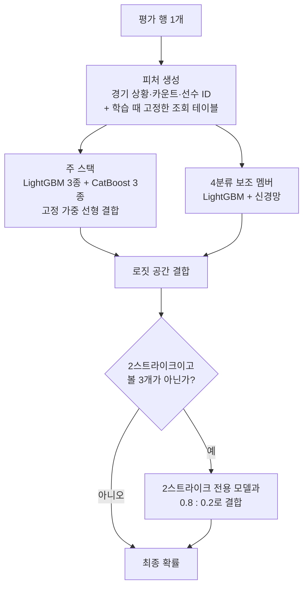

# LG Aimers 9기: 야구 데이터 해커톤, 투구 제구 성공 확률 예측

**LG Aimers 9기** 해커톤 Phase 2 참가 코드입니다. 투구 한 개가 한 행이고, 투구 직전까지 알 수 있는 정보만으로 그 투구의 제구 성공(`control_success`, 0/1) 확률을 예측하는 문제입니다. 2019~2024년 데이터로 학습해서 2025년을 예측합니다.

최종 순위는 **참가자 약 2,400명 중 98위**입니다.

> English summary: code for the LG Aimers 9th hackathon (Phase 2). It predicts the probability that each pitch hits its control target, using only pre-pitch information. A fixed-weight stack of LightGBM and CatBoost components plus a 4-class auxiliary member (LightGBM and a small neural net) produces each prediction from one row and lookup tables frozen at training time. Best public leaderboard score 1146.597; final rank 98 of about 2,400.

## 결과

| 항목 | 값 |
|---|---|
| 최종 순위 | 98위 / 약 2,400명 |
| Public 리더보드 최고점 | **1146.597** (이 저장소의 `submit/`) |

점수는 Brier 점수를 기준으로 한 값이고, 높을수록 좋습니다. Brier가 1 micro-Brier(0.000001) 줄면 점수가 약 0.40점 오릅니다.

## 문제와 규칙

- **train.csv:** 약 147만 행(2019~2024)입니다. 경기 상황(이닝, 카운트, 주자, 점수 차, 승리 확률), 투수·타자·팀 ID, 운영 측이 제공한 사전 이력 피처(`asof_*`) 19개가 있습니다.
- **trackman_history.csv:** 투구 단위 물리 측정값(구속, 회전수, 무브먼트, 릴리스 포인트 등)입니다. train.csv와 바로 이어 붙일 키가 없어서, 투수 ID 대응을 추정해서 복원했습니다. 2025년 측정값은 제공되지 않습니다.
- **test.csv:** 2025년 데이터이고 정답이 없습니다.
- **game_type:** 1군 정규 시즌(R)과 퓨처스리그(F)로 나뉩니다.

규칙의 핵심은 **행 단위 독립 예측**입니다. 평가 데이터의 다른 행으로 만든 누적, 빈도, rolling, target encoding은 쓸 수 없습니다. 그래서 모든 예측은 그 행 하나와 학습 때 고정해 둔 조회 테이블만으로 계산합니다. `submit/` 코드는 `test.csv` 전체에 대한 통계를 한 번도 계산하지 않습니다.

## 방법



**1. 피처**
- 경기 상황, 카운트, 주자, 점수 차 같은 원본 컬럼을 씁니다.
- 학습 데이터에서만 만든 시간 안전 target encoding과, 시간 감쇠를 준 상호작용 encoding을 씁니다.
- 투수·타자 이력과 직전 상태에서 현재 상태로의 제구 전이 피처를 씁니다.
- TrackMan에서 2019~2024년 투수별 궤적과 구종 특성을 모아 조회 테이블로 고정했습니다.
- LightGBM은 309개(감쇠 버전 331개), CatBoost는 118개(감쇠 버전 140개) 피처를 씁니다.

**2. 주 스택**
- 컴포넌트 6개의 고정 가중 선형 결합입니다: LightGBM(15 leaves, 31 leaves, 감쇠 피처), CatBoost(기본, 감쇠 분류, 감쇠 회귀).
- 컴포넌트마다 시드 여러 개를 평균합니다. 저장된 모델은 CatBoost 153개, LightGBM 26개입니다.
- 퓨처스리그(F) 행에는 퓨처스 전용 LightGBM을 따로 씁니다.

**3. 4분류 보조 멤버**
- 제구 결과를 네 가지로 나눠 예측하는 LightGBM 3개와 신경망 64개(시드)입니다.
- 신경망은 추론할 때 numpy만으로 계산합니다(`submit/_multi.py`).
- 주 스택과 고정 계수로 결합합니다.

**4. 2스트라이크 전용 모델**
- 2스트라이크(볼 3개 제외) 행만으로 학습한 LightGBM(시드 5개)입니다.
- 그 구간에서만 `sigmoid(0.8 × logit(주 예측) + 0.2 × logit(전용 모델))`로 섞습니다.
- 섞기 전보다 Public 점수가 1144.511 → 1146.597로 +2.086 올랐습니다.

## 폴더 구조

```text
submit/
  script.py               평가 진입점: 주 스택 + 4분류 멤버 + 2스트라이크 모델 결합
  _prod.py                피처 생성과 주 스택 추론 (학습 코드도 이 파일을 불러 씀)
  _multi.py               4분류 멤버 추론과 numpy 신경망 forward
  model/                  주 스택 모델, 조회 테이블(meta.pkl), manifest.json
  model_multi/            4분류 멤버 모델과 결합 설정(blend.json)
  strike_specialist.json  2스트라이크 모델 설정
  trackman_candidate.json TrackMan 피처 신뢰도 게이트 설정
  level_shift.json        리그별 레벨 설정
  requirements.txt        추론에 필요한 패키지
train_submit.py           주 스택 학습과 submit/model 패키징
```

## 실행

### 추론

대회 데이터를 `submit/data/`에 넣습니다.

```bash
pip install -r submit/requirements.txt
# submit/data/test.csv, submit/data/sample_submission.csv 준비
python submit/script.py
# 결과: submit/output/submission.csv
```

저장된 모델 파일을 그대로 쓰므로 학습 없이 제출 결과를 재현할 수 있습니다. 평가 서버 기준 추론 시간은 약 187초였습니다.

### 학습

```bash
pip install -r submit/requirements.txt scipy
# offer/data/train.csv, offer/data/trackman_history.csv 준비
python train_submit.py
```

- `train_submit.py`는 주 스택(LightGBM, CatBoost)을 다시 학습해서 `submit/model/`에 패키징합니다.
- 학습 중에는 `submit/model.build/`에 먼저 만들고, 끝나면 교체합니다.
- 피처는 `submit/_prod.py`를 그대로 불러 만들기 때문에 학습과 추론이 같은 피처를 씁니다.
- 4분류 멤버, 시드 확장, 2스트라이크 모델은 별도 실험 스크립트로 만들었고, 이 저장소에는 결과 모델만 들어 있습니다.

## 공개 범위와 데이터

- 대회 데이터(`train.csv`, `test.csv`, `trackman_history.csv`, `sample_submission.csv`)는 넣지 않았습니다. 대회 주최 측의 데이터 이용 약관을 따릅니다.
- 학습된 모델과, 학습 데이터에서 만든 조회 테이블(`meta.pkl`)은 들어 있습니다. 둘 다 제출 패키지의 일부입니다.
- `*.pkl`은 pickle 파일입니다. 이 저장소에서 받은 파일만 여세요.
- 실험 기록과 중간 산출물은 이 저장소에 넣지 않았습니다.

## 라이선스

코드는 [MIT License](LICENSE)를 따릅니다. 대회 데이터는 LG Aimers 대회 약관을 따르고, LightGBM·CatBoost 등 사용한 라이브러리는 각자의 라이선스를 따릅니다.
